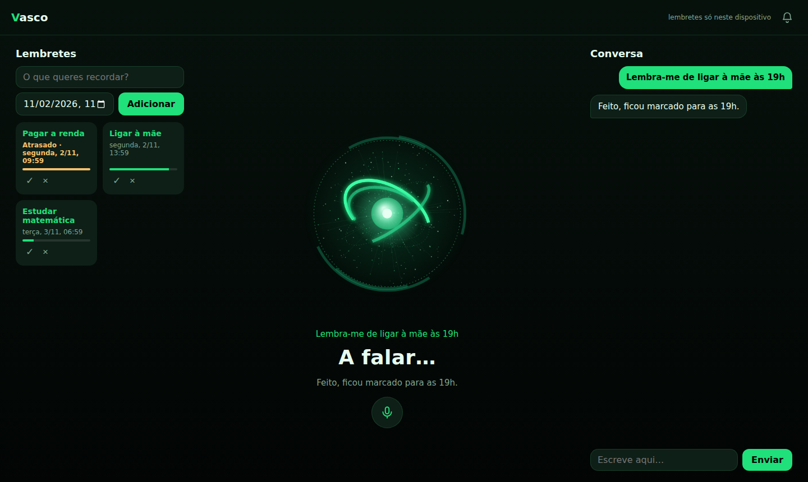
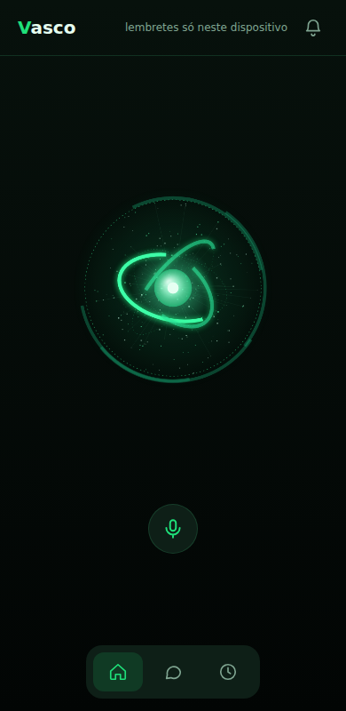

<p align="center"></p>

# Camões

Assistente virtual pessoal em português de Portugal, inspirado no JARVIS. Corre no teu PC e usas no PC e no telemóvel (como app instalável).

- Conversa por texto e por voz, com uma esfera animada.
- Quatro modos: Geral, Estudo, Programação e Criativo.
- Lembretes guardados no servidor, iguais em todos os dispositivos.
- Funciona com Claude (Anthropic), OpenAI ou modelos locais (Ollama, LM Studio).
- Sem dependências: só precisas do Node.js.

| PC | Telemóvel |
| --- | --- |
|  |  |

## Guião rápido

### 1. Instalar

1. Instala o [Node.js](https://nodejs.org) (versão 18 ou mais recente). Confirma com `node -v`.
2. Descarrega o projeto:

   ```bash
   git clone https://github.com/herberttrabalho2008-bot/Assistente_Virtual.git
   cd Assistente_Virtual
   ```

Não há `npm install`: o projeto não tem dependências.

### 2. Arrancar

No Windows, faz duplo clique em `iniciar.bat`. Em qualquer sistema:

```bash
npm start
```

Deve aparecer `Camões a correr em http://localhost:3000`. Deixa essa janela aberta: se a fechares, o Camões pára. Para parar, carrega em `Ctrl+C`.

### 3. Escolher a API

1. Abre http://localhost:3000 no browser.
2. Clica na roda dentada (**Definições**), no canto de cima à direita.
3. Escolhe o fornecedor e preenche:
   - **Anthropic (Claude):** cola a tua chave da API. O modelo já vem preenchido.
   - **Compatível com OpenAI:** endereço, modelo e chave. Para um modelo local com Ollama usa `http://localhost:11434/v1`, o nome do modelo (por exemplo `llama3`) e deixa a chave vazia.
4. Clica em **Guardar** e depois em **Testar**. Se aparecer uma resposta, está pronto.

A chave fica só no teu computador (`data/settings.json`, fora do Git) e nunca volta a aparecer no browser.

### 4. Usar

- **Escrever:** abre a conversa e escreve a mensagem.
- **Falar:** carrega no botão do microfone (precisa de Chrome ou Edge).
- **Lembretes:** adiciona-os na lista, ou pede ao Camões, por exemplo "lembra-me de ligar à mãe às 19h".
- **Modo e cor:** nas Definições escolhes o modo (Geral, Estudo, Programação ou Criativo), que muda o estilo das respostas, e a cor do Camões (verde, azul ou vermelho). Ficam guardados só nesse dispositivo.
- **No telemóvel:** a barra de baixo troca entre a esfera, a Conversa e os Lembretes. No PC vês tudo ao mesmo tempo.

Sem API configurada, os lembretes funcionam na mesma. Só a conversa fica desligada.

## Usar no telemóvel

O telemóvel tem de conseguir chegar ao PC onde o Camões está a correr. Antes de abrires o Camões à rede, tens de definir um código de acesso.

1. Copia `.env.example` para `.env` e preenche `CAMOES_TOKEN` com um código longo e aleatório. Sem ele, o Camões só aceita ligações do próprio PC.
2. Reinicia o Camões. Com o código definido, passa a aceitar ligações de outros dispositivos.
3. No telemóvel, abre o endereço do Camões. A app pede o código na primeira vez e guarda-o.

Há duas formas de chegar ao Camões, e a escolha importa:

| Forma | O que funciona |
| --- | --- |
| Mesma rede Wi-Fi: `http://IP-do-PC:3000` | Texto e lembretes. O browser **bloqueia** microfone, notificações e instalação. |
| HTTPS (recomendado) | Tudo: voz, notificações e instalar como app. |

Para ter HTTPS usa um túnel ou um servidor com certificado, por exemplo Tailscale (`tailscale serve`), Cloudflare Tunnel ou uma VPS com Caddy. Este passo ainda não está montado neste projeto.

Para instalar a app: no Chrome (Android) usa "Instalar app"; no Safari (iPhone) usa Partilhar e "Adicionar ao ecrã principal".

**Cuidado:** nunca expões o Camões à internet sem `CAMOES_TOKEN`. Quem lá entrar gasta a tua chave da API e pode mudar as definições. Define também um limite de gastos na conta da API.

## Configuração (opcional)

Tudo se pode fazer em **Definições**. Se preferires ficheiro, copia `.env.example` para `.env` (o `.env` nunca vai para o GitHub). O que gravares em Definições tem prioridade sobre o `.env`.

| Variável | Para quê |
| --- | --- |
| `ANTHROPIC_API_KEY` | Chave da Anthropic |
| `OPENAI_API_KEY` | Chave da OpenAI |
| `CAMOES_TOKEN` | Código de acesso (obrigatório fora do PC) |
| `PORT` | Porta do servidor (por omissão 3000) |
| `CAMOES_PROVIDER` | `anthropic` ou `openai` |
| `CAMOES_MODEL`, `CAMOES_OPENAI_MODEL` | Modelo de cada fornecedor |
| `CAMOES_OPENAI_BASE_URL` | Endereço da API compatível com OpenAI |

## Problemas comuns

- **`node` não é reconhecido:** o Node.js não está instalado, ou é preciso fechar e abrir de novo o terminal.
- **A porta 3000 já está em uso:** o Camões já está a correr noutra janela, ou outro programa usa a porta. Fecha-o, ou muda `PORT` no `.env`.
- **A conversa dá erro de chave:** abre Definições, confirma a chave e clica em **Testar**.
- **Modelo local não responde:** confirma que o Ollama ou o LM Studio está aberto e que o nome do modelo está certo.
- **O microfone não funciona no telemóvel:** precisa de HTTPS (ver acima). No Firefox a voz não funciona.
- **Os dados do Camões:** lembretes e definições ficam na pasta `data/`. Apaga-a para recomeçar do zero.

## Limitações

- Os avisos de lembretes só aparecem com a app aberta. Com a app fechada seria preciso Web Push, que ainda não está feito.
- A voz usa o reconhecimento do browser. No Chrome, o áudio vai para a Google.
- O Camões não controla o PC.
- O histórico da conversa perde-se quando recarregas a página.
- O servidor limita a 20 mensagens por minuto por IP, mas isso não substitui um limite de gastos na conta da API.

A lista do que falta fazer está em [TODO.md](TODO.md).

## Para quem quer mexer no código

```bash
npm test         # testes do servidor (node --test)
npm run icons    # volta a gerar a logo e os ícones
```

```
server.js            ponto de entrada (só liga as peças)
iniciar.bat          arranque com duplo clique no Windows
src/
  config.js          variáveis de ambiente e leitura do .env
  store.js           lembretes em data/reminders.json
  settings.js        fornecedor, modelo e chave (data/settings.json)
  assistant.js       prompt, modos, ferramentas e chamadas ao modelo
  http.js            ficheiros estáticos, autenticação e rotas /api
public/              a app (sem build: módulos ES nativos)
  index.html, sw.js, manifest.webmanifest, ícones
  css/style.css
  js/                main, chat, voice, reminders, orb, theme, settings, ui, api, util
test/                testes do servidor
tools/make-icons.js  desenha a logo e gera os ícones
imagens/             logo (logo.png, gerada por npm run icons) e imagens do ecrã
legacy/              protótipos originais (só funcionavam dentro do claude.ai)
data/                lembretes e definições (criada ao correr; fora do Git)
```
