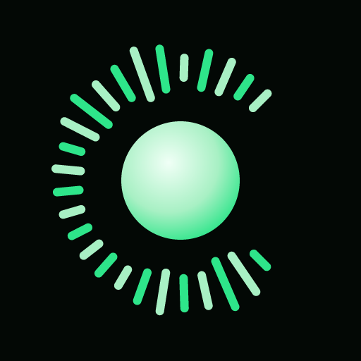
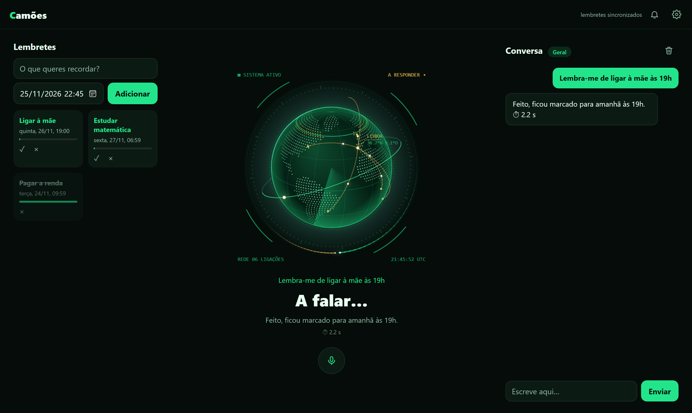
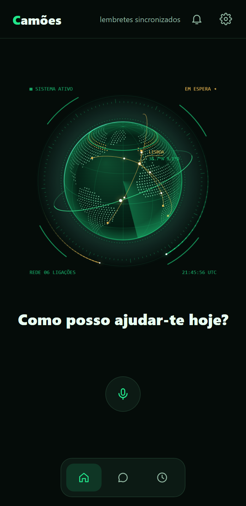
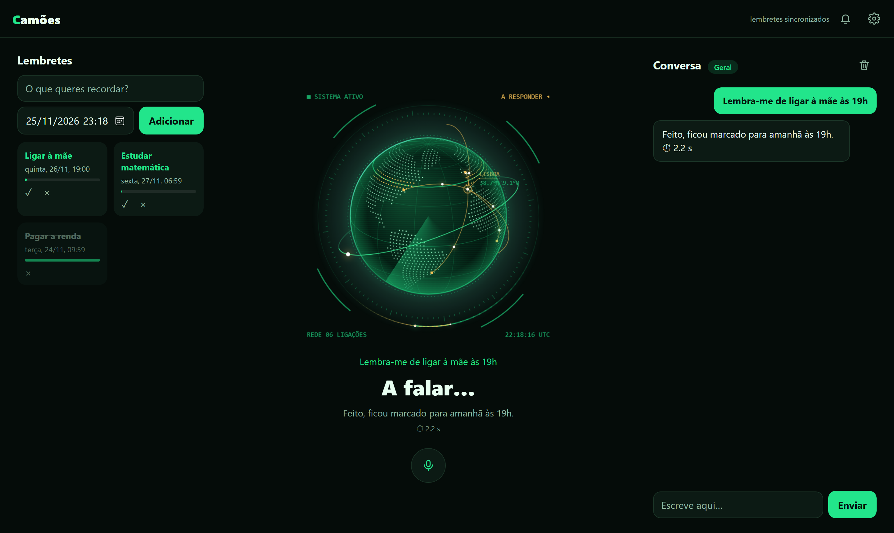
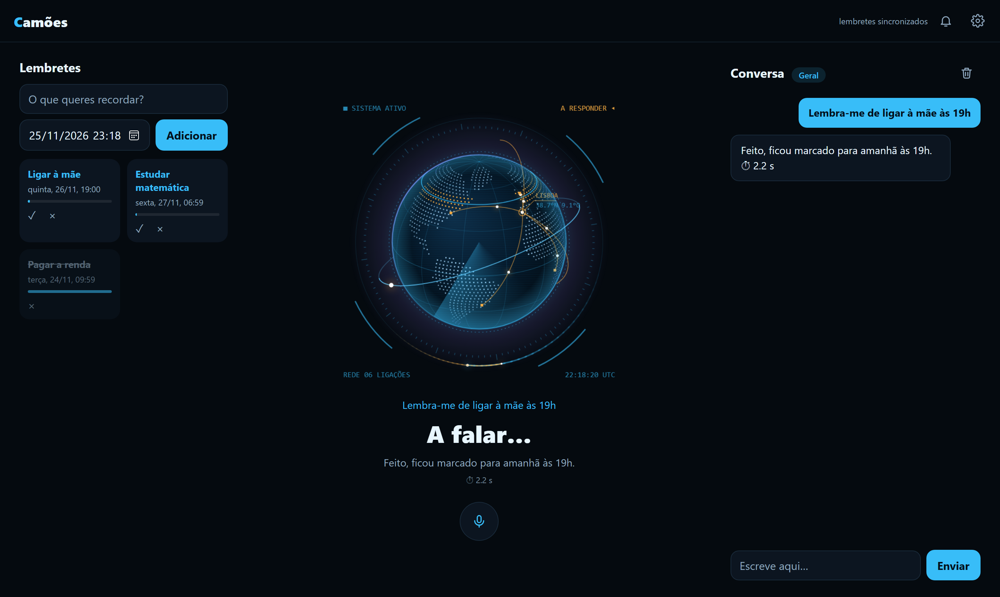
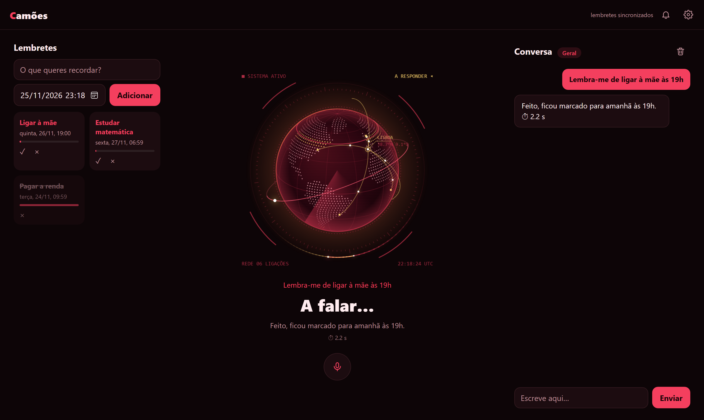

<p align="center"></p>

# Camões

**Versão 0.4.0**

Assistente virtual pessoal em português de Portugal, inspirado no JARVIS. Corre no teu PC e usas no PC e no telemóvel (como app instalável).

- Conversa por texto e por voz, com um globo terrestre futurista e personalizável.
- As respostas aparecem à medida que são escritas (streaming), com um contador de segundos.
- Quatro modos: Geral, Estudo, Programação e Criativo.
- Lembretes guardados no servidor, iguais em todos os dispositivos.
- Vem pronto para a **API da NVIDIA** (gratuita) com o modelo `nvidia/nemotron-3.5-lightning-30b-a3b`, e também funciona com Claude (Anthropic), OpenAI ou modelos locais (Ollama, LM Studio).
- Sem dependências: só precisas do Node.js.

| PC | Telemóvel |
| --- | --- |
|  |  |

O globo e tudo o que mudou está descrito em [Novidades](#novidades) e em [Personalizar o globo](#personalizar-o-globo).

## Novidades

Versão 0.4.0: tudo o que está abaixo. O número da versão está no `package.json` e aparece no fundo das Definições.

### Globo futurista
- A esfera deu lugar a um **globo holográfico em WebGL**, refeito de raiz: uma esfera de vidro escuro com os continentes reais (Natural Earth) lisos e com a costa a brilhar, grelha ténue, linha de varrimento e uma atmosfera a brilhar na orla.
- **Ligações de dados:** arcos finos que partem da tua cidade (Lisboa por omissão) para outras seis, a esbater-se para o destino, com um pulso de luz a viajar e um pequeno anel em cada cidade.
- **Anéis à volta:** uma linha fina, três arcos que desvanecem nas pontas, uma escala de marcas, dois cometas e um satélite em órbita (que passa por trás do planeta).
- **Duas cores por tema:** além da cor principal (verde, azul ou vermelho) há uma cor de contraste e uma atmosfera noutro tom (por exemplo âmbar sobre o azul).
- O globo reage aos estados do assistente: roda mais depressa ao pensar e pulsa ao falar.


### As três cores

A cor escolhe-se em **Definições**. Cada tema tem a sua cor principal e uma cor de contraste (podes trocá-la na secção Globo).

| Verde | Azul | Vermelho |
| --- | --- | --- |
|  |  |  |

### Respostas mais rápidas
- **Streaming:** o texto aparece à medida que o modelo o escreve, tanto na Anthropic como nas APIs compatíveis com OpenAI.
- **Voz por frases:** em modo de voz, o Camões começa a falar logo que a primeira frase está completa.
- **Menos pedidos falhados:** se um modelo recusar ferramentas, o servidor lembra-se e deixa de as enviar, em vez de repetir o pedido em cada mensagem.
- **Contador de segundos** em cada resposta, no ecrã principal e no chat.
- **Mensagem clara** quando o modelo devolve uma resposta vazia, em vez de mostrar só "…".
- O modelo por omissão é o `nvidia/nemotron-3.5-lightning-30b-a3b`, muito mais rápido do que modelos gigantes como o `mistral-large-4-1t`.

### Conversa
- **Respostas com formatação:** código (em blocos e em linha), listas, títulos, negrito e itálico aparecem bem formatados. É seguro: o texto do modelo nunca é tratado como HTML.
- **Indicador "a escrever"** (três pontos) enquanto o Camões não responde.
- **Botão de limpar a conversa** (ícone de lixo): toca duas vezes para apagar o histórico, os balões e o texto do ecrã principal.

### Interface
- No PC, os lembretes e a conversa estão em **painéis de vidro** sobre um fundo com um halo suave, e o cabeçalho é translúcido.
- Microfone com anel a pulsar quando está a ouvir, cartões de lembretes com realce ao passar o rato e balões de conversa com entrada suave.

### Definições redesenhadas
- Cartões por secção (Modo e cor, Globo, API), com ícones, interruptores, slider, seletor de cor redondo e botões novos.
- Animação ao abrir, fundo desfocado e cabeçalho fixo; funciona bem no PC e no telemóvel.

## Guião rápido

### 1. Instalar

1. Instala o [Node.js](https://nodejs.org) (versão 18 ou mais recente). Confirma com `node -v`.
2. Descarrega o projeto:

   ```bash
   git clone https://github.com/herberttrabalho2008-bot/Assistente_Virtual.git
   cd Assistente_Virtual
   ```

Não há `npm install`: o projeto não tem dependências.

### 2. Arrancar

No Windows, faz duplo clique em `iniciar.bat`. Em qualquer sistema:

```bash
npm start
```

Deve aparecer `Camões a correr em http://localhost:3000`. Deixa essa janela aberta: se a fechares, o Camões pára. Para parar, carrega em `Ctrl+C`.

### 3. Escolher a API

1. Abre http://localhost:3000 no browser.
2. Clica na roda dentada (**Definições**), no canto de cima à direita.
3. O Camões já vem configurado para a **NVIDIA** (fornecedor "Compatível com OpenAI", endereço `https://integrate.api.nvidia.com/v1` e modelo `nvidia/nemotron-3.5-lightning-30b-a3b`). Só tens de colar a tua chave, que começa por `nvapi-` e se cria de graça em [build.nvidia.com](https://build.nvidia.com). Para usar outra coisa, escolhe o fornecedor e preenche:
   - **Anthropic (Claude):** cola a tua chave da API. O modelo já vem preenchido.
   - **Compatível com OpenAI:** endereço, modelo e chave (OpenAI, NVIDIA com outro modelo, etc.). Para um modelo local com Ollama usa `http://localhost:11434/v1`, o nome do modelo (por exemplo `llama3`) e deixa a chave vazia.
4. Clica em **Guardar** e depois em **Testar**. Se aparecer uma resposta, está pronto.

A chave fica só no teu computador (`data/settings.json`, fora do Git) e nunca volta a aparecer no browser.

### 4. Usar

- **Escrever:** abre a conversa e escreve a mensagem. A resposta aparece aos poucos, com o tempo que demorou.
- **Limpar a conversa:** toca duas vezes no ícone de lixo, no topo da Conversa.
- **Falar:** carrega no botão do microfone (precisa de Chrome ou Edge). O Camões começa a responder logo na primeira frase.
- **Lembretes:** adiciona-os na lista, ou pede ao Camões, por exemplo "lembra-me de ligar à mãe às 19h".
- **Modo e cor:** nas Definições escolhes o modo (Geral, Estudo, Programação ou Criativo), que muda o estilo das respostas, e a cor do Camões (verde, azul ou vermelho). Ficam guardados só nesse dispositivo.
- **No telemóvel:** a barra de baixo troca entre a esfera, a Conversa e os Lembretes. No PC vês tudo ao mesmo tempo.

Sem API configurada, os lembretes funcionam na mesma. Só a conversa fica desligada.

## Personalizar o globo

Em **Definições**, na secção **Globo**, tudo se aplica ao vivo:

| Opção | O que faz |
| --- | --- |
| A tua cidade | Escolhe entre 16 cidades (Lisboa, Porto, Funchal, Praia, Luanda, Maputo, São Paulo, Rio, Londres, Paris, Madrid, Nova Iorque, Dubai, Joanesburgo, Tóquio, Sydney). Fica marcada no globo e as ligações partem dela. |
| Velocidade de rotação | De 0× (parado) a 3×. |
| Cor de contraste | Seletor de cor livre para as ligações, o marcador, um cometa e o satélite. "Automática" volta à cor do tema. |
| Interruptores | Ligações de dados, marcar a minha cidade, grelha e linha de varrimento e anéis/cometas/satélite. |
| Repor o globo | Volta a todas as predefinições. |

As escolhas ficam guardadas só no dispositivo (no PC e no telemóvel são independentes).

### Mexer no globo com o rato ou os dedos

No ecrã inicial, o globo é interativo:

| Gesto | O que faz |
| --- | --- |
| Arrastar | Roda o globo (e inclina-o), com inércia ao largar. A rotação automática pára enquanto mexes e volta devagar. |
| Roda do rato / pinça (telemóvel) | Zoom de 0,6× a 3×. |
| Shift + arrastar (ou botão direito) | Move o globo no ecrã. |
| Duplo clique | Repõe o zoom, a posição, a inclinação e a rotação (volta a mostrar a tua cidade). |

### Escolher um modelo rápido

A velocidade depende sobretudo do modelo. Modelos gigantes (centenas de milhares de milhões de parâmetros) podem demorar dezenas de segundos só a começar, sobretudo em contas gratuitas. Para conversa normal, um modelo leve responde em poucos segundos. Se ficar fraco para perguntas difíceis, volta a um maior nas Definições. O contador de segundos mostra o tempo real de cada resposta.

## Usar no telemóvel

O telemóvel tem de conseguir chegar ao PC onde o Camões está a correr. Antes de abrires o Camões à rede, tens de definir um código de acesso.

1. Copia `.env.example` para `.env` e preenche `CAMOES_TOKEN` com um código longo e aleatório. Sem ele, o Camões só aceita ligações do próprio PC.
2. Reinicia o Camões. Com o código definido, passa a aceitar ligações de outros dispositivos.
3. No telemóvel, abre o endereço do Camões. A app pede o código na primeira vez e guarda-o.

Há duas formas de chegar ao Camões, e a escolha importa:

| Forma | O que funciona |
| --- | --- |
| Mesma rede Wi-Fi: `http://IP-do-PC:3000` | Texto e lembretes. O browser **bloqueia** microfone, notificações e instalação. |
| HTTPS (recomendado) | Tudo: voz, notificações e instalar como app. |

Para ter HTTPS usa um túnel ou um servidor com certificado, por exemplo Tailscale (`tailscale serve`), Cloudflare Tunnel ou uma VPS com Caddy. Este passo ainda não está montado neste projeto.

Para instalar a app: no Chrome (Android) usa "Instalar app"; no Safari (iPhone) usa Partilhar e "Adicionar ao ecrã principal".

**Cuidado:** nunca expões o Camões à internet sem `CAMOES_TOKEN`. Quem lá entrar gasta a tua chave da API e pode mudar as definições. Define também um limite de gastos na conta da API.

## Configuração (opcional)

Tudo se pode fazer em **Definições**. Se preferires ficheiro, copia `.env.example` para `.env` (o `.env` nunca vai para o GitHub). O que gravares em Definições tem prioridade sobre o `.env`.

| Variável | Para quê |
| --- | --- |
| `ANTHROPIC_API_KEY` | Chave da Anthropic |
| `OPENAI_API_KEY` | Chave do fornecedor compatível com OpenAI (por omissão a NVIDIA, `nvapi-…`) |
| `CAMOES_TOKEN` | Código de acesso (obrigatório fora do PC) |
| `PORT` | Porta do servidor (por omissão 3000) |
| `CAMOES_PROVIDER` | `anthropic` ou `openai` (por omissão `openai`, a NVIDIA; só com `ANTHROPIC_API_KEY` definida passa a `anthropic`) |
| `CAMOES_MODEL`, `CAMOES_OPENAI_MODEL` | Modelo de cada fornecedor (por omissão `claude-sonnet-5-5` e `nvidia/nemotron-3.5-lightning-30b-a3b`) |
| `CAMOES_OPENAI_BASE_URL` | Endereço da API compatível com OpenAI (por omissão `https://integrate.api.nvidia.com/v1`) |

## Problemas comuns

- **`node` não é reconhecido:** o Node.js não está instalado, ou é preciso fechar e abrir de novo o terminal.
- **A porta 3000 já está em uso:** o Camões já está a correr noutra janela, ou outro programa usa a porta. Fecha-o, ou muda `PORT` no `.env`.
- **A conversa dá erro de chave:** abre Definições, confirma a chave e clica em **Testar**.
- **Modelo local não responde:** confirma que o Ollama ou o LM Studio está aberto e que o nome do modelo está certo.
- **O microfone não funciona no telemóvel:** precisa de HTTPS (ver acima). No Firefox a voz não funciona.
- **Os dados do Camões:** lembretes e definições ficam na pasta `data/`. Apaga-a para recomeçar do zero.

## Limitações

- Os avisos de lembretes só aparecem com a app aberta. Com a app fechada seria preciso Web Push, que ainda não está feito.
- A voz usa o reconhecimento do browser. No Chrome, o áudio vai para a Google.
- O Camões não controla o PC.
- O histórico da conversa (últimas 40 mensagens) fica guardado no browser, só nesse dispositivo: no PC e no telemóvel são independentes, e apagam-se ao limpar a conversa ou os dados do site.
- O globo precisa de WebGL (todos os browsers atuais o têm). Sem ele, aparece um disco simples e perdem-se os continentes.
- Em modelos que não aceitam ferramentas (alguns da NVIDIA e locais), a conversa funciona mas o Camões não cria lembretes por ti.
- O servidor limita a 20 mensagens por minuto por IP, mas isso não substitui um limite de gastos na conta da API.

A lista do que falta fazer está em [TODO.md](TODO.md).

## Para quem quer mexer no código

```bash
npm test         # testes do servidor (node --test)
npm run icons    # volta a gerar a logo e os ícones
node tools/make-land.js ne_110m_land.geojson   # volta a gerar public/data/land.json
```

```
server.js            ponto de entrada (só liga as peças)
iniciar.bat          arranque com duplo clique no Windows
src/
  config.js          variáveis de ambiente e leitura do .env
  store.js           lembretes em data/reminders.json
  settings.js        fornecedor, modelo e chave (data/settings.json)
  assistant.js       prompt, modos, ferramentas e chamadas ao modelo
  http.js            ficheiros estáticos, autenticação e rotas /api
public/              a app (sem build: módulos ES nativos)
  index.html, sw.js, manifest.webmanifest, ícones
  css/style.css
  js/                main, chat, md (markdown simples), voice, reminders, orb (o globo em WebGL), globeui (opções do globo),
                     theme, settings, ui, api, util
test/                testes do servidor (http, settings, store e streaming)
tools/make-icons.js  desenha a logo e gera os ícones
tools/make-land.js   converte o GeoJSON do Natural Earth em public/data/land.json
imagens/             logo (logo.png, gerada por npm run icons) e imagens do ecrã
legacy/              protótipos originais (só funcionavam dentro do claude.ai)
data/                lembretes e definições (criada ao correr; fora do Git)
```

## Créditos

Os continentes do globo vêm do [Natural Earth](https://www.naturalearthdata.com) (dados de terra 1:110m, domínio público), guardados em `public/data/land.json`.
